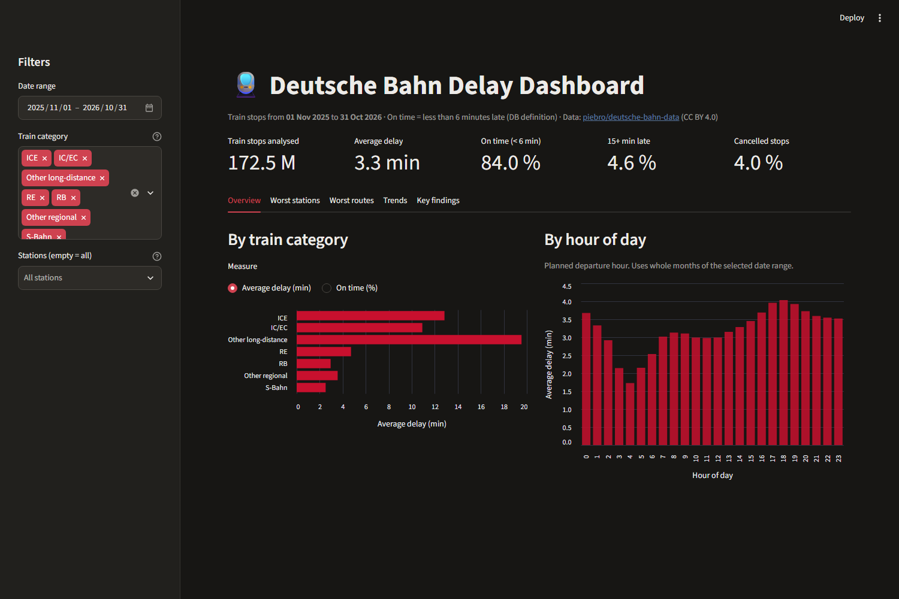
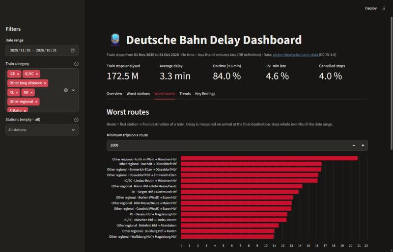
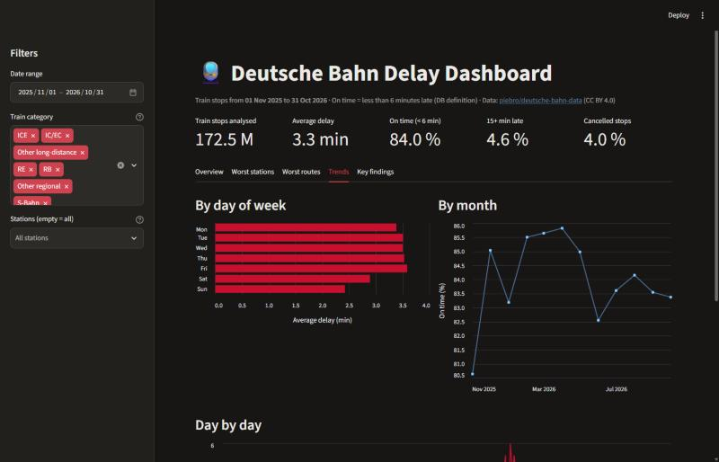

# 🚆 Deutsche Bahn Delay Dashboard

An interactive dashboard that analyses **172.5 million train stops** at **5,428 German stations**
over one full year (Nov 2025 – Oct 2026), built with Python, DuckDB SQL and Streamlit.

**▶ Live demo:** [db-delay-dashboard.streamlit.app](https://db-delay-dashboard-jx3rartsy7emodj5wfsduu.streamlit.app)



## The problem

Everyone who takes trains in Germany has an opinion about delays, but few people have seen the numbers.
Which train types, stations, routes and times of day are really the most delayed?
This project turns open Deutsche Bahn data into a dashboard that answers these questions with filters
for date range, train category and station.

## Key findings

Computed by [`scripts/key_findings.py`](scripts/key_findings.py) from the full dataset. Every number comes from a SQL query, not typed in by hand.

1. **Overall:** the average delay was **3.3 minutes**; **84.0%** of stops were on time (less than 6 minutes late), 4.6% were 15+ minutes late and 4.0% were cancelled.
2. **Train category:** S-Bahn was the most punctual (87.7% on time), "Other long-distance" (e.g. Nightjet, Flixtrain, TGV) the least (47.7% on time, average delay 19.5 min).
3. **Time of day:** trains planned at 18:00–18:59 had the highest average delay (4.0 min); 04:00–04:59 the lowest (1.7 min).
4. **Day of week:** Friday had the highest average delay (3.6 min), Sunday the lowest (2.4 min).
5. **Month:** April 2026 was the most punctual month (85.8% on time), November 2025 the least (80.6%).
6. **Big stations** (the 100 busiest): Duisburg Hbf had the highest average delay (9.3 min, 57.4% on time); Berlin Beusselstraße the lowest (1.1 min).
7. **Worst route** (at least 1,000 trips): Furth im Wald → München Hbf (regional trains), arriving on average 20.8 min late (2,084 trips).

**By train category:**

| Category | Train stops | Avg delay (min) | On time |
|---|---:|---:|---:|
| S-Bahn | 79.6 M | 2.5 | 87.7% |
| RB | 23.3 M | 3.0 | 85.4% |
| Other regional | 49.1 M | 3.6 | 82.3% |
| RE | 17.2 M | 4.7 | 76.1% |
| IC/EC | 0.8 M | 10.9 | 57.1% |
| ICE | 2.3 M | 12.9 | 53.7% |
| Other long-distance | 0.2 M | 19.5 | 47.7% |

Long-distance trains are far less punctual than regional ones. One possible explanation, not tested in this
project, is that they travel hundreds of kilometres, so delays build up along the way.

| Worst routes | Trends |
|---|---|
|  |  |

## Data source

[piebro/deutsche-bahn-data](https://huggingface.co/datasets/piebro/deutsche-bahn-data) on Hugging Face,
licensed under [CC BY 4.0](https://creativecommons.org/licenses/by/4.0/). It contains snapshots of the
**Deutsche Bahn Timetables API**, collected several times a day since July 2024.

**Why only Nov 2025 – Oct 2026?** While exploring the data ([`scripts/explore_data.py`](scripts/explore_data.py))
I found that the dataset grew from **131 stations** (Oct 2025) to **5,339 stations** (Nov 2025).
Comparing months across that change would mix two different station sets, so the analysis uses one complete year
with consistent coverage.

## How it works

```
Raw monthly Parquet files (178.6 M rows, ~4.2 GB)
   │  scripts/clean_data.py        → cleaning rules, train categories
   ▼
Cleaned stops (172.5 M rows, local only)
   │  scripts/build_aggregates.py  → runs sql/*.sql with DuckDB
   ▼
Summary tables in app_data/ (34 MB)  →  app.py (Streamlit + DuckDB)
```

- **Cleaning** ([report](reports/cleaning_report.md)): removed stops without a delay value (0.83%), rail replacement
  buses and taxis (2.58%) and impossible values more than 5 minutes early (0.02%). ~100 raw train types are
  grouped into 7 categories. Stop ids were checked for duplicates (none found).
- **Definitions:** *on time* = less than 6 minutes late, DB's official definition. Delays are measured at each stop
  (departure, or arrival at the final stop). **Cancelled stops are excluded from delay averages** and reported
  separately as the cancellation rate.
- **Why summary tables?** 172 million rows don't fit on free hosting. The SQL queries store **sums and counts**
  (never averages) per day/station/category, so the dashboard can still calculate correct averages for any filter.
- **Routes** are defined as first station → final destination of a train's run, and measured by the arrival delay
  at the destination.

## Limitations

- The data comes from API snapshots, not DB's official punctuality statistics, so numbers can differ from
  published figures.
- The hour-of-day chart and the routes table are stored per month, so they filter by whole months.
- Trains that were diverted or ended early form their own "route" entries, which is why the route ranking uses a
  minimum number of trips.

## Run it locally

Requires Python 3.10+. In PowerShell:

```powershell
git clone https://github.com/ommggkrish/db-delay-dashboard.git
cd db-delay-dashboard
python -m venv .venv
.\.venv\Scripts\Activate.ps1
python -m pip install -r requirements.txt
streamlit run app.py
```

The summary tables are included in the repo, so the dashboard runs right away.
To rebuild everything from the raw data (~4.2 GB download):

```powershell
mkdir data
foreach ($m in "2025-11","2025-12","2026-01","2026-02","2026-03","2026-04","2026-05","2026-06","2026-07","2026-08","2026-09","2026-10") {
  curl.exe -L -o "data/data-$m.parquet" "https://huggingface.co/datasets/piebro/deutsche-bahn-data/resolve/main/monthly_processed_data/data-$m.parquet"
}
python scripts/clean_data.py
python scripts/build_aggregates.py
python scripts/key_findings.py
```

## Project structure

```
app.py                     Streamlit dashboard
sql/                       SQL analysis queries (one summary table each)
scripts/explore_data.py    First look at the raw data
scripts/clean_data.py      Cleaning rules → data/clean/stops.parquet
scripts/build_aggregates.py  Runs sql/*.sql → app_data/*.parquet
scripts/key_findings.py    Computes the key findings → reports/key_findings.md
app_data/                  Summary tables used by the dashboard
reports/                   Cleaning report and key findings
```

## Tech stack

Python · pandas · DuckDB (SQL) · Streamlit · Altair · Parquet

---

Data: [piebro/deutsche-bahn-data](https://huggingface.co/datasets/piebro/deutsche-bahn-data), CC BY 4.0, originally from Deutsche Bahn APIs.
This is an independent student project and is not affiliated with Deutsche Bahn.
